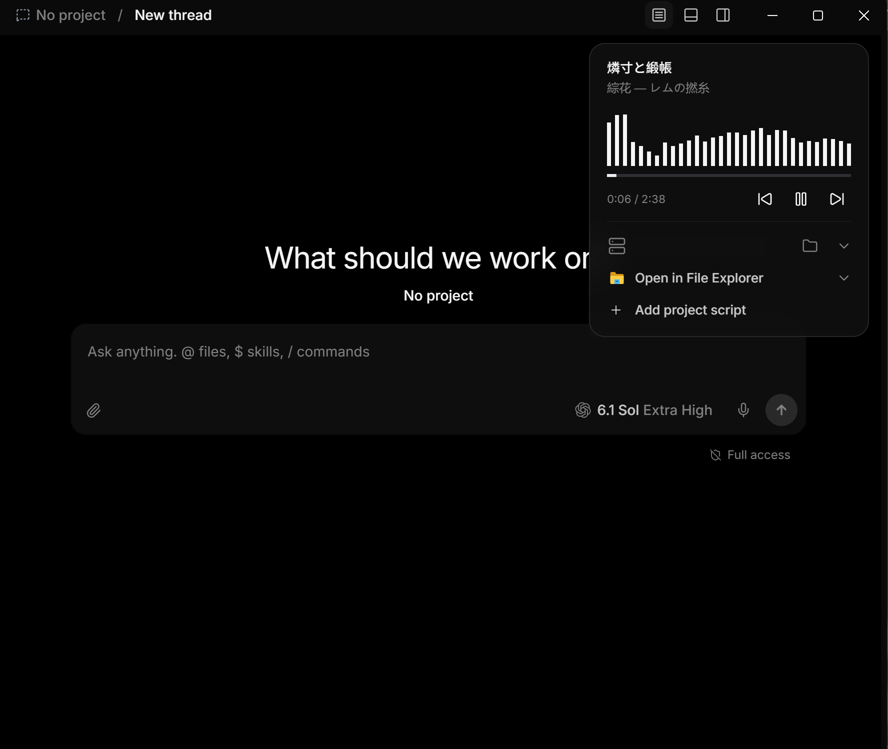

This theme was developed entirely by Claude Fable 5.2 and GPT 6.1 Sol.

# T3 Code Music Theme

T3 Music is a monochrome music player inside T3 Code's thread details card,
with a live 31-band spectrum, playback controls, and an agent-native /music skill.

Live spectrum and playback controls in T3 Code's floating details card.

- The player works in the sidebar and floating details card, in light and dark mode.
- Agents can build, reorder, search, shuffle, and save playlists.
- A ten-band equalizer changes the audio and spectrum, with presets and per-band gains.

Playlist and equalizer controls stay out of the T3 interface. The bundled skill
is also published separately at
[t3-code-music-skill](https://github.com/RAKiQWQ/t3-code-music-skill).

## Install on Windows

Requires T3 Code with theme customization, Python 3.10 or newer, and FFmpeg
(both ffmpeg and ffprobe on PATH). Audio uses the default Windows WASAPI device.

From a downloaded release or this checkout, run in PowerShell:

    python -m pip install -r requirements.txt
    .\install.ps1 -Python python

Pass an absolute interpreter path to -Python if you have several Python installs.
The installer records it, so later PATH changes do not select another interpreter.
Select **T3 Music** in T3 Code's theme picker. Its theme ID is
mono-player, retained for existing installations.

The card is drawn by the theme and worked by a background player; while the
player is not running, clicks on the card do nothing. The installer therefore
turns on autostart: a startup entry named T3 Music, for your Windows account
only, runs a small watcher from sign-in, and the watcher starts the player,
paused, each time T3 Code is started. Closing T3 Code leaves the player
running. After stop it stays stopped until T3 Code is started again or you
run start:

    & "$env:USERPROFILE\.t3\tools\t3-music\music.ps1" start

Switch autostart with autostart off and autostart on. Pass -NoAutostart to
install without changing it, and run autostart off before deleting the player
directory.

The installer places /music in the Codex and Claude skill folders, including
CODEX_HOME when set. Start a new agent session to discover a newly installed
skill. Use -SkipSkills to install only the player, or -Destination to change
the player directory.

Upgrades stop the old player and retain its runtime state. With autostart on
and T3 Code open, the player returns within seconds; otherwise run start. The
saved queue, track, position, volume, repeat mode, and EQ return paused.

## Use with an agent

Examples:

    /music
    /music play
    /music add D:\Music\Album to the playlist
    /music save this playlist as Evening
    /music play track 3
    /music cut the 1 kHz band by 4 dB
    /music use the bass preset

A bare /music reads status. The agent can control playback even when another
theme is selected.

## Command line

Use the installed music.ps1 launcher, or call t3music.py with its recorded
Python interpreter. Put --json before the command for machine-readable output;
failed commands return ok: false and a nonzero exit code.

| Command | Result |
| --- | --- |
| start / stop | Start or exit the background player |
| autostart on / off / status | Start the player with T3 Code, stop doing so, or report the setting |
| play / pause / toggle | Control playback |
| next / prev | Change track; prev first restarts after three seconds |
| seek 60 / seek 1:30 / seek 50% | Seek by seconds, time, or percentage |
| vol 30 | Set volume from 0 to 100 |
| open "D:\Music" | Replace the queue with a folder and play |
| open "D:\Music\song.flac" | Play a file with its folder as the queue |
| status | Read playback state |
| playlist list [TEXT] | Inspect or search queue entries with 1-based indices |
| playlist add PATH / remove N / move FROM TO / play N | Edit or select queue entries |
| playlist clear / shuffle | Clear or shuffle the queue |
| playlist repeat all / one / off | Loop all tracks, loop one, or stop at the end |
| playlist save NAME / load NAME / saved / delete NAME | Manage named playlists |
| eq presets / preset NAME | List or apply flat, bass, treble, or vocal |
| eq set HZ DB / curve DB1 ... DB10 | Set one band or a full curve |
| eq off / on / reset | Bypass, enable, or flatten EQ |

For example:

    & "$env:USERPROFILE\.t3\tools\t3-music\music.ps1" --json playlist list "Album"
    & "$env:USERPROFILE\.t3\tools\t3-music\music.ps1" --json eq set 1k -4

Adding tracks does not interrupt playback. Queue edits preserve the current
track when possible. Loading a saved playlist selects its first track paused
if the current track is absent. Saved playlists store paths, not audio copies.

EQ bands: 31, 62, 125, 250, 500, 1000, 2000, 4000, 8000, 16000 Hz; each
accepts -12 to +12 dB. Boosts include automatic gain compensation. Flat and
disabled curves bypass processing. EQ updates apply to newly processed blocks,
each covering up to 80 ms of audio. The filters have the phase response of a
causal equalizer.

## Implementation and checks

FFmpeg decodes to 48 kHz stereo float32, preserving precision from 24-bit files.
Builds with SoXR use it for resampling; essentials builds use FFmpeg's built-in
resampler with a 64-tap filter. Decoder failures appear in JSON status and the log.
The audio writer queues only the frames supplied, avoiding SoundCard 0.4.6's
unwritten-buffer playback. The SoundCard version is pinned because that writer
uses its Windows backend internals. Nonflat EQ uses streaming overlap-add
convolution in 80 ms blocks with single-precision transforms, while the device
still receives 20 ms chunks. The spectrum follows the applied curve and volume.
The writer waits for enough buffer space to send a chunk, and the audio thread
waits for commands while paused.

Theme CSS animates precomputed spectrum windows. The file refreshes about
every four seconds, so switching threads can briefly move the display out of
step. Spectrum computation and theme writes stop while all T3 Code windows
are minimized, hidden, or on another virtual desktop, and resynchronize when
a window returns. CSS draws the controls; a Windows helper recognizes clicks
using screen pixels around the pointer, in memory. It supports T3 Code desktop windows.

At sign-out and shutdown, Windows gives no notice to a process that has
neither a window nor a console, so the player keeps a hidden window to be
told. It then saves its state and restores the idle card before it exits, as
it does for stop. The autostart watcher is the same script in a mode that
loads no audio code. Every two seconds it looks for a T3 Code process that
shows a window, and it starts the player when a new one appears.

Run the focused regression checks:

    python -m unittest -v

The tests cover EQ response and continuity, queue editing and persistence,
command errors, 24-bit decoding, theme limits, the audio buffer regression,
autostart, and the exit at sign-out.
The decoder check needs FFmpeg; the suite skips it when FFmpeg is unavailable.
Tests do not control the installed player or its startup entry.

For an isolated process, T3_MUSIC_HOME sets the runtime directory,
T3_MUSIC_USERDATA selects a separate T3 userdata directory, and
T3_MUSIC_HEADLESS=1 disables the theme and mouse integration.

MIT licensed. T3 Code, Python, FFmpeg, and the audio dependencies are installed
separately.
